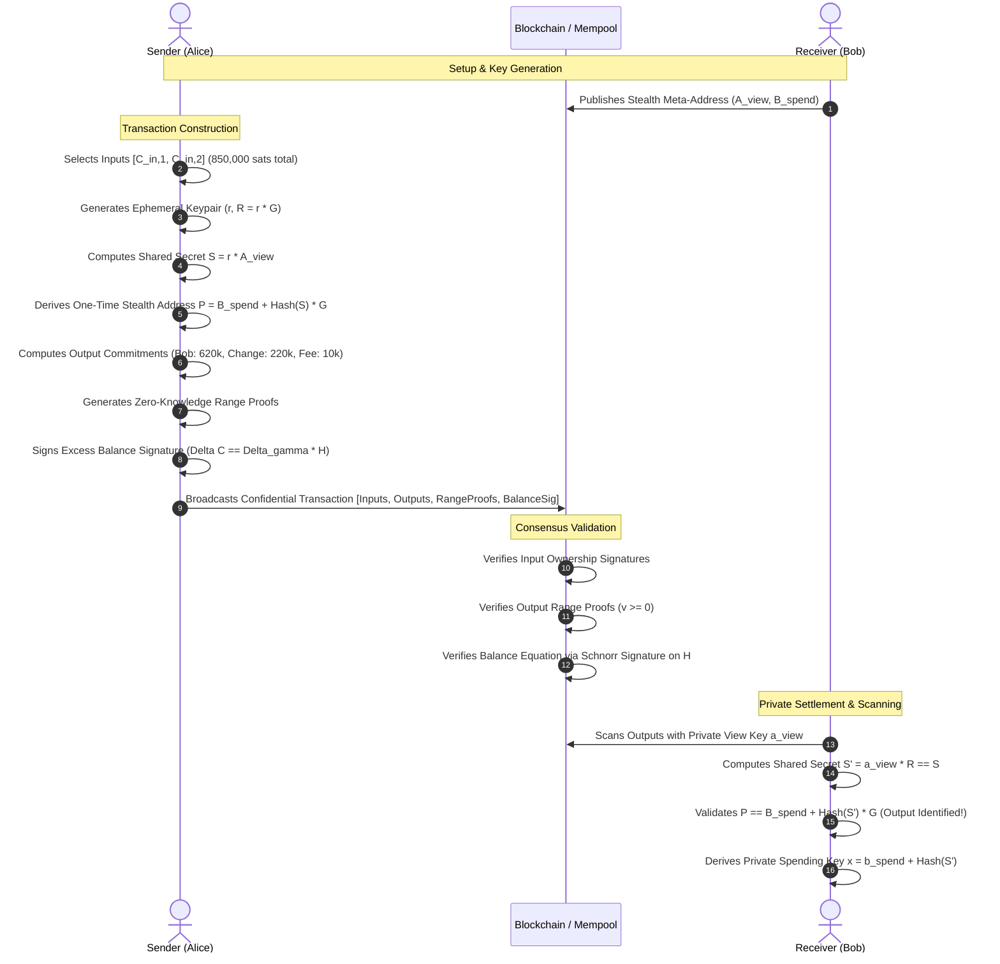

# NyxShield

<p align="center">
  <strong>High-Performance Zero-Knowledge Bulletproofs & Confidential Asset Settlement Protocol in Rust</strong>
</p>

<p align="center">
  <a href="https://github.com/ZengLLQ/nyx-shield/actions"></a>
  
  
  
  
</p>

---

## 🔒 Overview

**NyxShield** is an industrial-grade cryptographic library and settlement engine implementing non-interactive Zero-Knowledge Bulletproofs, logarithmic Inner-Product Arguments (IPA), Dual-Key Stealth Address Protocols (DKSAP), and homomorphic value balance verification over the prime-order **Ristretto255** group.

### Core Cryptographic Features
- **Logarithmic Inner-Product Argument (IPA):** Compresses arbitrary vector inner products $\langle \mathbf{a}, \mathbf{b} \rangle = c$ into $2 \lceil \log_2 n \rceil$ group elements via recursive Bootle-Bünz folding.
- **Aggregated Multi-Range Proofs:** Proves in zero-knowledge that $m$ secret values each satisfy $v_j \in [0, 2^n - 1]$ (for $n \in \{8, 16, 32, 64\}$) without revealing amounts, preventing negative balance overflow and inflation attacks.
- **Dual-Key Stealth Addresses (DKSAP):** Cryptographic unlinkability between senders and receivers using ephemeral Diffie-Hellman key exchange, enabling receivers to privately scan and claim UTXOs without revealing public meta-addresses.
- **Homomorphic Value Conservation:** Preserves exact asset conservation ($\sum v_{in} = \sum v_{out} + \text{Fee}$) using Pedersen commitment blinding factors and a Schnorr excess balance signature over basepoint $H$.
- **Transparent Setup (NUMS):** Zero trusted setup or toxic waste. Basepoints and vector generators are deterministically derived via domain-separated SHA-512 hash-to-group mappings.

---

## 📐 Mathematical Formulation

### 1. Vector Pedersen Commitments
Given public generators $G, H \in \mathbb{G}$ and orthogonal generator vectors $\mathbf{G}, \mathbf{H} \in \mathbb{G}^n$:
$$C = v \cdot G + \gamma \cdot H + \langle \mathbf{a}_L, \mathbf{G} \rangle + \langle \mathbf{a}_R, \mathbf{H} \rangle$$
where $v$ is the committed value and $\gamma \in \mathbb{F}_p$ is a cryptographically random blinding factor.

### 2. Inner-Product Argument (IPA)
To prove relation $P = \langle \mathbf{a}, \mathbf{G} \rangle + \langle \mathbf{b}, \mathbf{H} \rangle + \langle \mathbf{a}, \mathbf{b} \rangle \cdot Q$, the prover recursively halves vectors $\mathbf{a}, \mathbf{b}$ of dimension $n$:
$$L_k = \langle \mathbf{a}_{lo}, \mathbf{G}_{hi} \rangle + \langle \mathbf{b}_{hi}, \mathbf{H}_{lo} \rangle + \langle \mathbf{a}_{lo}, \mathbf{b}_{hi} \rangle \cdot Q$$
$$R_k = \langle \mathbf{a}_{hi}, \mathbf{G}_{lo} \rangle + \langle \mathbf{b}_{lo}, \mathbf{H}_{hi} \rangle + \langle \mathbf{a}_{hi}, \mathbf{b}_{lo} \rangle \cdot Q$$

Using Fiat-Shamir challenge $u_k \in \mathbb{F}_p$:
$$\mathbf{a}' = \mathbf{a}_{lo} \cdot u_k + \mathbf{a}_{hi} \cdot u_k^{-1}$$
$$\mathbf{b}' = \mathbf{b}_{lo} \cdot u_k^{-1} + \mathbf{b}_{hi} \cdot u_k$$

In $k = \lceil \log_2 n \rceil$ rounds, the proof reduces to scalar pair $(a, b)$ and cross-commitments $(L_k, R_k)_{k=1}^{\log n}$.

### 3. Multi-Value Range Proof System
A secret amount $v$ is bit-decomposed into binary vector $\mathbf{a}_L \in \{0, 1\}^n$:
$$\langle \mathbf{a}_L, \mathbf{2}^n \rangle = v, \quad \mathbf{a}_R = \mathbf{a}_L - \mathbf{1}^n, \quad \mathbf{a}_L \circ \mathbf{a}_R = \mathbf{0}^n$$

Vectors are masked with blinding polynomials $\mathbf{s}_L, \mathbf{s}_R \in \mathbb{F}_p^n$:
$$l(X) = (\mathbf{a}_L - z \cdot \mathbf{1}) + \mathbf{s}_L \cdot X$$
$$r(X) = \mathbf{y}^n \circ (\mathbf{a}_R + z \cdot \mathbf{1} + \mathbf{s}_R \cdot X) + \sum_{j=0}^{m-1} z^{j+2} \cdot \mathbf{2}^n$$

Polynomial $t(X) = \langle l(X), r(X) \rangle = t_0 + t_1 X + t_2 X^2$ satisfies:
$$t_0 = \sum_{j=0}^{m-1} z^{j+2} v_j + \delta(y, z)$$
The verifier checks polynomial consistency in a single multi-scalar multiplication (MSM):
$$\hat{t} \cdot G + \tau_x \cdot H \stackrel{?}{=} \sum_{j=0}^{m-1} z^{j+2} V_j + \delta(y, z) \cdot G + x \cdot T_1 + x^2 \cdot T_2$$

### 4. Homomorphic Balance Preservation
In a confidential transaction with inputs $(C_{in, i})$ and outputs $(C_{out, j})$:
$$\Delta C = \sum_{i=1}^{p} C_{in, i} - \sum_{j=1}^{q} C_{out, j} - \text{Fee} \cdot G$$
When value is conserved ($\sum v_{in} = \sum v_{out} + \text{Fee}$), the $G$ term vanishes:
$$\Delta C = \left(\sum_{i=1}^{p} \gamma_{in, i} - \sum_{j=1}^{q} \gamma_{out, j}\right) \cdot H = \Delta \gamma \cdot H$$
The prover computes a Schnorr signature under key $\Delta \gamma$ with respect to basepoint $H$. If an attacker attempts inflation ($\sum v_{out} > \sum v_{in}$), $\Delta C$ retains a non-zero $G$ component, rendering signature creation mathematically impossible without solving the discrete logarithm between $G$ and $H$.

---

## 🔄 Protocol Flow



---

## 📦 Project Structure

```
NyxShield/
├── Cargo.toml                 # Crate manifest & dependencies
├── LICENSE                    # MIT License
├── README.md                  # Cryptographic specification & benchmarks
├── src/
│   ├── lib.rs                 # Library entry point & primary exports
│   ├── errors.rs              # Cryptographic & protocol error taxonomy
│   ├── transcript.rs          # Domain-separated Fiat-Shamir transcript (Sha512)
│   ├── generators.rs          # NUMS Pedersen & vector generator derivation
│   ├── pedersen.rs            # Homomorphic commitments & multi-scalar multiplication
│   ├── inner_product.rs       # Logarithmic O(log n) Inner-Product Argument
│   ├── range_proof.rs         # Multi-value Bulletproofs range proof system
│   ├── stealth.rs             # Dual-Key Stealth Address Protocol (DKSAP)
│   └── confidential_tx.rs     # Confidential transaction ledger & balance verifier
├── tests/
│   ├── inner_product_tests.rs # Folding correctness, tampering & dimension checks
│   ├── range_proof_tests.rs   # Range boundaries, invalid values, multi-range proofs
│   ├── stealth_tests.rs       # Stealth address scanning & spending key recovery
│   └── confidential_tx_tests.rs # End-to-end transfers, balance conservation & inflation guards
└── examples/
    ├── confidential_settlement.rs # Complete confidential transfer simulation
    └── range_proof_demo.rs       # Range proof prove/verify latency & size analysis
```

---

## ⚡ Quick Start

### Installation

Add `nyx-shield` to your `Cargo.toml`:

```toml
[dependencies]
nyx-shield = "0.1.0"
```

### Confidential Transfer Example

```rust
use nyx_shield::{BulletproofGenerators, ConfidentialTransaction, StealthKeypair};
use curve25519_dalek::scalar::Scalar;
use rand::rngs::OsRng;

fn main() -> Result<(), Box<dyn std::error::Error>> {
    let mut rng = OsRng;
    let generators = BulletproofGenerators::new(128);
    let bits = 32;

    // 1. Generate identity keypairs
    let alice = StealthKeypair::generate(&mut rng);
    let bob = StealthKeypair::generate(&mut rng);

    // 2. Define Alice's inputs (Total 100,000 sats)
    let in_values = [60_000u64, 40_000u64];
    let in_blindings = [Scalar::random(&mut rng), Scalar::random(&mut rng)];
    let in_keys = [Scalar::random(&mut rng), Scalar::random(&mut rng)];

    // 3. Construct confidential transaction: 75,000 to Bob, 5,000 fee, 20,000 change
    let tx = ConfidentialTransaction::create(
        &generators,
        &in_values,
        &in_blindings,
        &in_keys,
        &[(bob.meta_address, 75_000u64)],
        &alice.meta_address,
        5_000u64,
        bits,
        &mut rng,
    )?;

    // 4. Node verifier validates all zero-knowledge proofs and value balance
    tx.verify(&generators, bits)?;
    println!("Transaction successfully verified on-chain!");

    // 5. Bob scans the transaction and recovers spending key
    let bob_spending_key = tx.outputs[0]
        .recipient_stealth
        .scan_and_derive_spending_key(&bob)
        .expect("Bob should detect his payment");
    println!("Bob claimed output with derived private key!");

    Ok(())
}
```

---

## 🧪 Testing & Verification

Run the full cryptographic test suite:

```bash
cargo test --verbose
```

Run demonstration simulations:

```bash
cargo run --example confidential_settlement
cargo run --example range_proof_demo
```

---

## 📚 References

1. **Bünz, B., Bootle, J., Boneh, D., Poelstra, A., Wuille, P., & Maxwell, G.** (2018). Bulletproofs: Short proofs for confidential transactions and more. *IEEE Symposium on Security and Privacy (S&P)*, 315-334.
2. **Bootle, J., Cerulli, A., Chaidos, P., Groth, J., & Petit, C.** (2016). Efficient zero-knowledge arguments for arithmetic circuits in the discrete log setting. *EUROCRYPT 2016*, 327-357.
3. **Maxwell, G.** (2015). Confidential Transactions. *Bitcoin Core Developer Documentation*.
4. **Poelstra, A.** (2016). Mimblewimble. *Cryptology ePrint Archive*.

---

## 📄 License

This project is licensed under the MIT License - see the [LICENSE](LICENSE) file for details.
